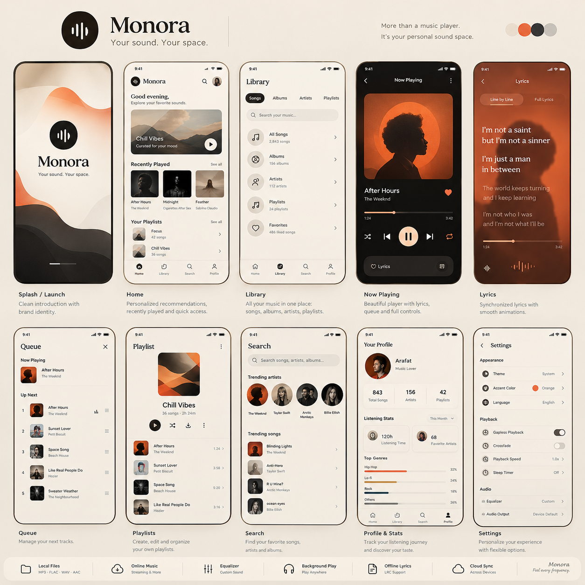

# Monora

**Your sound. Your space.**

Monora is a warm, offline-first music player for Android, built with Flutter. It plays the music already on your device — MP3, FLAC, WAV, AAC — with a beautiful interface, synced lyrics, a real equalizer, and zero accounts or tracking.

**[⬇ Download the latest APK](https://github.com/explorearafat/Monora/releases/latest/download/Monora-1.0.1.apk)** · [Release notes](https://github.com/explorearafat/Monora/releases) · [Website](https://monoramusic.vercel.app)

<p>
  
</p>

## Features

- **Local library** — scans the device via MediaStore; handles MP3, FLAC, WAV, AAC, OGG, OPUS with real artwork and graceful fallbacks
- **Full player** — play/pause, seek, shuffle, repeat (all/one), queue management with drag-reorder, mini-player with Hero expansion
- **Background playback** — media notification + lock-screen controls via `just_audio_background` (audio_service), audio focus & interruption handling, headphone unplug pause
- **Offline lyrics** — reads `.lrc` files (sibling to the audio file or in the app lyrics folder) with line-by-line sync and a full-lyrics mode; artwork-derived gradient backdrop
- **Real equalizer** — Android `Equalizer` + `LoudnessEnhancer` from `just_audio`'s audio pipeline, exposed with per-band sliders in Settings
- **Playlists & favorites** — locally persisted; recently played, play counts and listening-time stats
- **Search** — live filtering across songs, albums, artists with trending picks derived from listening history
- **Profile & stats** — top genres, listening time, favorite artists, editable profile name
- **Settings** — light/dark/system themes, five accent colors, playback speed, sleep timer, interruption handling, resume-last-session, audio output routing

## Build

```bash
flutter pub get
flutter test        # 39 tests
flutter analyze     # clean
flutter build apk --release
```

Requirements: Flutter 3.47+ with Dart 3.13+, JDK 17, Android SDK 36.

> **Note:** the `on_audio_query_android` plugin is vendored under [`packages/`](packages/) (via `dependency_overrides`) because the published version predates AGP 8 namespace requirements. It is identical to upstream 1.1.0 except for the namespace, compileSdk bump, and manifest cleanup.

## Project structure

```
lib/
  app/            app root, router, theme (colors, typography, motion)
  core/           shared widgets (logo, pressable, artwork, tiles) + utils (LRC parser, formatters)
  data/
    models/       Track, Album, Artist, MonoraPlaylist, GenreStat
    repositories/ media library, artwork cache, preferences, lyrics
  services/       MonoraPlayerService — the single audio engine (queue, focus, sleep timer, EQ)
  providers/      Riverpod wiring (library, permissions, settings, player)
  features/       splash, permission, shell, home, library, search, player, lyrics, profile, settings
```

## Privacy

Monora has no account, no analytics, and no network access for your music. Everything — playlists, favorites, stats — stays on your device.

## License

The Monora source is provided as-is for personal use. Bundled fonts: Playfair Display & Inter (SIL OFL). Icons: Material Symbols.
